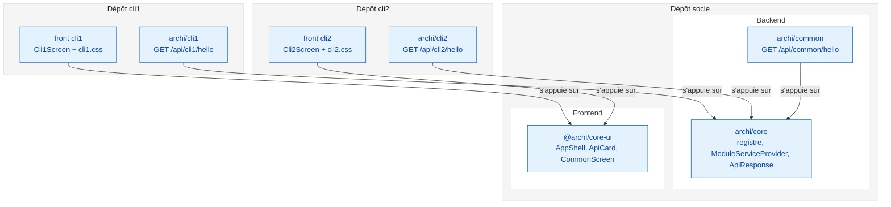
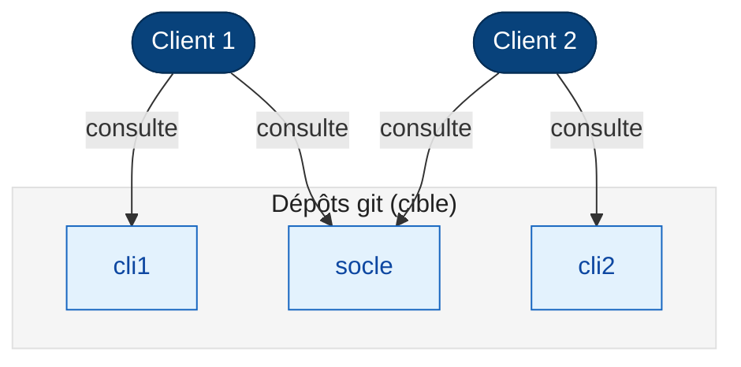
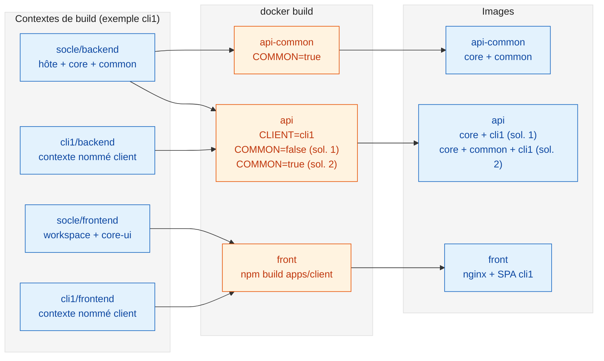
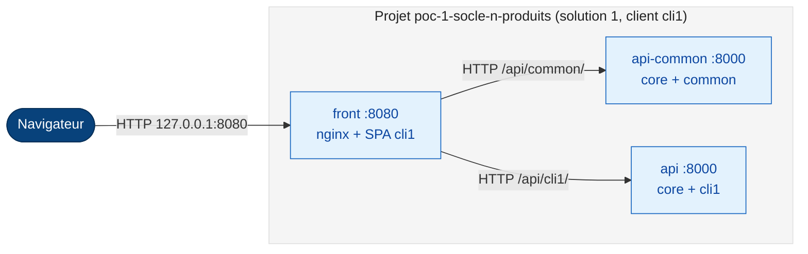
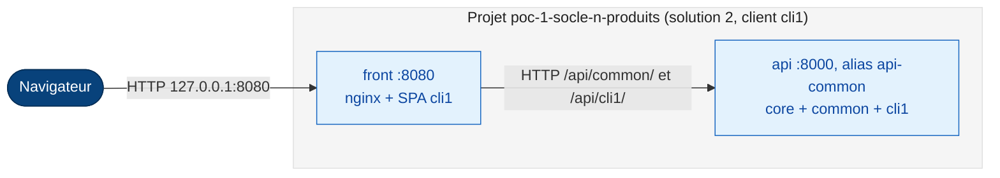
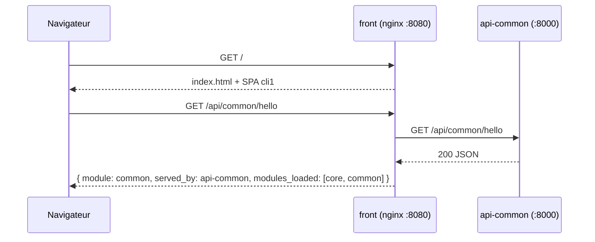

# POC 1 socle, N produits

Ce POC montre qu'un écosystème applicatif peut partager un **tronc commun** (`core`, `common`) tout en livrant à chaque client (`cli1`, `cli2`) ses **services et écrans spécifiques**, sans qu'aucun client ne reçoive le code d'un autre.

Un **produit** est l'assemblage du socle et des spécifiques d'un client : `cli1` et `cli2` donnent chacun un produit, d'où le nom « 1 socle, N produits ».

- **Backend** : Laravel 13 sur FrankenPHP, découpé en paquets Composer.
- **Frontend** : React 19 (Vite), avec des composants communs et une application par client.
- **Exécution** : Docker Compose, piloté par un Makefile minimal.

L'expression de besoin initiale est dans [docs/prompt_initial.md](docs/prompt_initial.md), le plan de construction dans [docs/plan_initial.md](docs/plan_initial.md) et les décisions d'architecture dans [docs/adr/](docs/adr/).

## Sommaire

1. [Ce que le POC démontre](#1-ce-que-le-poc-démontre)
2. [Organisation des sources](#2-organisation-des-sources)
3. [Assemblage des images](#3-assemblage-des-images)
4. [Déploiement : solution 1 et solution 2](#4-déploiement--solution-1-et-solution-2)
5. [Déroulé d'une requête](#5-déroulé-dune-requête)
6. [Composition Docker](#6-composition-docker)
7. [Utilisation](#7-utilisation)
8. [Trajectoire après le POC](#8-trajectoire-après-le-poc)
9. [Décisions d'architecture](#9-décisions-darchitecture)

## 1. Ce que le POC démontre

| Besoin | Réponse du POC |
|---|---|
| `core` est utilisé par tous mais n'est pas déployé seul | `archi/core` est une bibliothèque Composer : registre des modules, classe de base des modules, format de réponse |
| `common`, `cli1` et `cli2` s'appuient sur `core` | Chaque module est un paquet Composer qui requiert `archi/core` et monte ses routes sous `/api/<module>` |
| Solution 1 : API `common` et API `cliN` séparées | Deux conteneurs : `api-common` (core + common) et `api` (core + cliN) |
| Solution 2 : API `cliN` incluant `common` | Un seul conteneur `api` (core + common + cliN), activé par une surcharge Compose |
| Front : composants `core` et un front final par client | `@archi/core-ui` fournit la coquille, l'appel d'API et l'écran commun ; chaque client ajoute son écran et sa feuille CSS |
| Aucun code d'un autre client livré | Le code client n'entre dans le build que par un contexte nommé : le build de cli1 ne voit jamais `cli2/` |

Chaque réponse d'API indique `served_by` (l'API qui a répondu) et `modules_loaded` (les modules présents), et l'interface les affiche. On voit ainsi directement la différence entre les deux solutions.

## 2. Organisation des sources

Le POC tient dans un seul dépôt git, mais chaque répertoire de premier niveau préfigure un **futur dépôt**. Un client consultera son dépôt et le socle, jamais celui d'un autre client.

```
poc-1-socle-n-produits/
├── Makefile  README.md                # liant du POC
├── docs/                               # besoin initial, plan initial et ADR
├── socle/                              # futur dépôt « socle », lisible par tous les clients
│   ├── compose.yaml                    # composition de base (name: poc-1-socle-n-produits)
│   ├── compose-standalone.yaml         # surcharge de la solution 2
│   ├── backend/
│   │   ├── Dockerfile                  # image d'API, contexte nommé « client » facultatif
│   │   ├── host/                       # application Laravel hôte (squelette minimal)
│   │   └── packages/
│   │       ├── core/                   # archi/core
│   │       └── common/                 # archi/common : GET /api/common/hello
│   └── frontend/
│       ├── Dockerfile                  # image du front, contexte nommé « client »
│       ├── nginx/default.conf.template # service de la SPA et relais /api
│       └── packages/core-ui/           # @archi/core-ui
├── cli1/                               # futur dépôt « cli1 »
│   ├── compose-cli1.yaml               # paramètres du client 1
│   ├── backend/                        # archi/cli1 : GET /api/cli1/hello
│   └── frontend/                       # appli React du client 1 + cli1.css
└── cli2/                               # futur dépôt « cli2 », même structure
```



Accès prévus après la séparation des dépôts : chaque client consulte le socle et son propre dépôt.



**Backend.** Chaque module est un paquet Composer dont le `ServiceProvider`, découvert automatiquement par Laravel, hérite de `Archi\Core\ModuleServiceProvider`. Ce fournisseur déclare le module auprès du `ModuleRegistry` et monte ses routes sous `/api/<module>`. L'application `host/` n'a aucune route propre, hormis la sonde `/up`. Elle reçoit au build les paquets de la cible.

**Frontend.** `@archi/core-ui` fournit `AppShell` : en-tête, menu, contenu et pied de page, avec un DOM et des classes `app-*` identiques pour tous les clients. Il fournit aussi `ApiCard`, `useApi` et l'écran commun (`CommonScreen`, `commonMenuEntry`). Chaque client ajoute :

- son écran spécifique, qui appelle son web service ;
- sa feuille CSS, qui décide de toute la disposition et des couleurs.

| Client | Feuille | Menu | Couleurs |
|---|---|---|---|
| cli1 | [`cli1/frontend/src/cli1.css`](cli1/frontend/src/cli1.css) | Latéral gauche, sur toute la hauteur | Sobres : ardoise et un accent bleu sourd |
| cli2 | [`cli2/frontend/src/cli2.css`](cli2/frontend/src/cli2.css) | Horizontal, sous l'en-tête | Pastel : menthe, lavande, pêche |

## 3. Assemblage des images

Les images partent toujours d'un contexte de build du **socle**. Le code du client y entre uniquement par le **contexte nommé `client`** (`build.additional_contexts`), déclaré dans `cliN/compose-cliN.yaml`. Les arguments `COMMON` et `CLIENT` décident des paquets installés dans l'hôte Laravel.



Le Dockerfile du backend déclare une étape vide `FROM scratch AS client`. Le contexte nommé la remplace quand il est fourni, et elle reste vide pour `api-common`. Les dépendances Composer et npm sont résolues au build, pour chaque cible ([ADR 0010](docs/adr/0010-resolution-des-dependances-au-build.md)).

## 4. Déploiement : solution 1 et solution 2

Le navigateur ne parle qu'au conteneur `front`. Son nginx sert l'application React et relaie les chemins d'API vers deux noms fixes :

| Chemin | Destination |
|---|---|
| `/api/common/` | `api-common:8000` |
| `/api/${CLIENT}/` | `api:8000` |
| autre `/api/...` (par exemple l'API d'un autre client) | 404 |

Ces chemins se lisent dans [`socle/frontend/nginx/default.conf.template`](socle/frontend/nginx/default.conf.template).

### Solution 1 : API séparées



### Solution 2 : API du client incluant common

La surcharge `socle/compose-standalone.yaml` :

- désactive `api-common` ;
- construit `api` avec `COMMON=true` ;
- donne à `api` l'**alias réseau `api-common`**.

La configuration nginx du front est donc identique dans les deux solutions.



## 5. Déroulé d'une requête

Exemple de l'écran « Espace commun » du client 1 en solution 1. En solution 2, le même appel arrive au conteneur `api` par son alias, et la réponse contient `served_by: api-cli1`.



## 6. Composition Docker

| Fichier | Dépôt | Rôle |
|---|---|---|
| [`socle/compose.yaml`](socle/compose.yaml) | socle | `name: poc-1-socle-n-produits` ; services `front`, `api-common`, `api` et leur durcissement |
| [`cli1/compose-cli1.yaml`](cli1/compose-cli1.yaml), [`cli2/compose-cli2.yaml`](cli2/compose-cli2.yaml) | cliN | Contextes nommés `client`, `CLIENT=cliN`, `APP_NAME=api-cliN` |
| [`socle/compose-standalone.yaml`](socle/compose-standalone.yaml) | socle | Solution 2 : `api-common` désactivé (profil `split`), `api` avec `COMMON=true` et alias `api-common` |

Valeurs de `COMPOSE_FILE`, depuis la racine du dépôt :

| Client | Solution | `COMPOSE_FILE` |
|---|---|---|
| cli1 | 1 | `socle/compose.yaml:cli1/compose-cli1.yaml` |
| cli1 | 2 | `socle/compose.yaml:cli1/compose-cli1.yaml:socle/compose-standalone.yaml` |
| cli2 | 1 | `socle/compose.yaml:cli2/compose-cli2.yaml` |
| cli2 | 2 | `socle/compose.yaml:cli2/compose-cli2.yaml:socle/compose-standalone.yaml` |

Compose résout les chemins relatifs depuis le répertoire du **premier** fichier, ici `socle/`. C'est pourquoi `compose-cliN.yaml` référence `../cliN/...`, ce qui correspond à un clone du dépôt client placé à côté du socle.

**Durcissement** ([ADR 0009](docs/adr/0009-durcissement-des-conteneurs.md)) :

- exécution sous un UID/GID arbitraire (`APP_UID`/`APP_GID`, 10001 par défaut) ;
- `read_only: true`, avec des tmpfs (`mode=1777`) pour `/tmp`, `storage/framework/{views,cache}` et `/etc/nginx/conf.d` ;
- limites CPU et mémoire : API 0,5 CPU / 256 Mio, front 0,25 CPU / 64 Mio ;
- sondes de santé `curl`, présent dans les deux images (vérifié) : `/up` pour les API, `/` pour le front ;
- seul le front est publié, et uniquement sur `127.0.0.1:8080` (modifiable avec `FRONT_PORT`).

Images de base, vérifiées le 2026-10-08 :

| Usage | Image |
|---|---|
| API | `dunglas/frankenphp:1.13.0-php8.5-alpine` (PHP 8.5.11) |
| Composer, au build | `composer:2.10.3` |
| Build du front | `node:24.21.0-alpine` |
| Service du front | `nginxinc/nginx-unprivileged:1.30.5-alpine` |

## 7. Utilisation

Prérequis : Docker avec Compose v2 et `make`. Ni PHP ni Node ne sont nécessaires sur le poste.

```sh
make up                          # cli1, solution 1 (valeurs par défaut)
make up CLIENT=cli2              # cli2, solution 1
make up CLIENT=cli1 SOLUTION=2   # cli1, solution 2
make test CLIENT=cli1            # appelle /api/common/hello et /api/cli1/hello
make ps | make logs | make config
make down
```

Une seule combinaison est déployée à la fois : `make up` repart de zéro (`down`, puis `up --build --wait`). `down` utilise `--profile "*"` pour retirer aussi `api-common`, que la solution 2 désactive par profil. Il passe donc inaperçu d'un simple `down`.

L'interface est servie sur http://localhost:8080. Contrôles attendus :

| Contrôle | Résultat attendu |
|---|---|
| Solution 1 | `/api/common/hello` est servi par `api-common`, `/api/cli1/hello` par `api-cli1` |
| Solution 2 | Les deux réponses sont servies par `api-cli1`, avec `modules_loaded = [core, cli1, common]` |
| API d'un autre client | `curl localhost:8080/api/cli2/hello` sur un déploiement cli1 → `404` |
| Isolation | `docker compose exec api ls /app/vendor/archi` → `cli1 common core` (solution 2) ; jamais `cli2` |
| Durcissement | `docker compose exec api id` → `uid=10001` ; `touch /app/x` → `Read-only file system` |

## 8. Trajectoire après le POC

- **Séparation des dépôts** : `socle`, `cli1` et `cli2` deviennent trois dépôts. Les droits de consultation suivent le schéma de la section 2.
- **Distribution du socle** :
  - `archi/core` et `archi/common` publiés dans un registre Composer privé (Satis ou registre de paquets GitLab) ;
  - `@archi/core-ui` publié dans un registre npm privé.
  
  Les dépôts `path` et le workspace du build disparaissent alors au profit de versions publiées.
- **Assemblage** : un contexte nommé peut être une URL git. Un dépôt client peut aussi récupérer le socle en sous-module ou en clone voisin, pour garder les chemins `../cliN`.
- **Points ouverts** :
  - versionner des fichiers lock par cible ([ADR 0010](docs/adr/0010-resolution-des-dependances-au-build.md)) ;
  - proposer un mode développement (serveur Vite et rechargement à chaud), absent du POC ;
  - nommer et étiqueter les images, aujourd'hui `poc-1-socle-n-produits-<service>` reconstruites à chaque `make up` ;
  - écrire des tests automatisés.

## 9. Décisions d'architecture

| ADR | Décision |
|---|---|
| [0001](docs/adr/0001-consigner-les-decisions-en-adr.md) | Consigner les décisions d'architecture en ADR (MADR) |
| [0002](docs/adr/0002-decoupage-en-futurs-depots.md) | Découper les sources en futurs dépôts `socle`, `cli1`, `cli2` |
| [0003](docs/adr/0003-modules-backend-en-paquets-composer.md) | Modules backend en paquets Composer Laravel auto-découverts |
| [0004](docs/adr/0004-une-image-par-cible.md) | Une image par cible, assemblée par contextes de build nommés |
| [0005](docs/adr/0005-deux-topologies-par-surcharge-compose.md) | Deux topologies de déploiement, sélectionnées par une surcharge Compose |
| [0006](docs/adr/0006-frankenphp.md) | FrankenPHP comme serveur des API Laravel |
| [0007](docs/adr/0007-front-core-ui-et-css-par-client.md) | Front : composants partagés, DOM unique, une feuille CSS par client |
| [0008](docs/adr/0008-nginx-du-front-en-reverse-proxy.md) | nginx du front en reverse proxy des API |
| [0009](docs/adr/0009-durcissement-des-conteneurs.md) | Durcissement des conteneurs |
| [0010](docs/adr/0010-resolution-des-dependances-au-build.md) | Résolution des dépendances au build (compromis du POC) |
